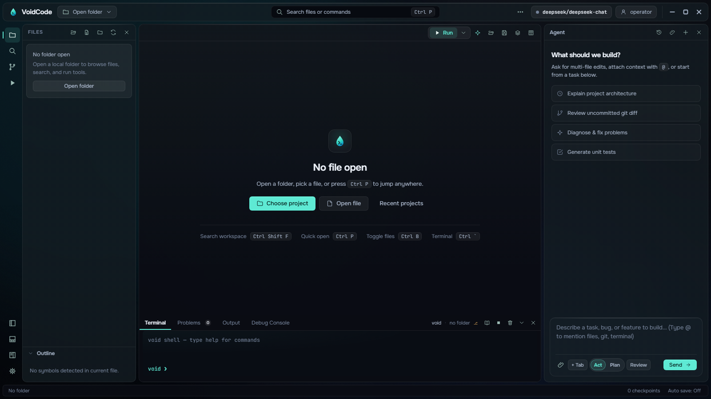

# VoidCode

**The Native, Local-First AI-Native IDE for Windows, macOS & Linux — Powered by VoidAgent Core.**

[](../../releases)
[](#quick-start-install-in-10-seconds)
[](#build-test-and-package-from-source)
[](#build-test-and-package-from-source)
[](LICENSE)



**VoidCode** is a fast, native cross-platform IDE (~70 MB self-contained `.NET 10` + WebView2 / WKWebView / WebKitGTK + Monaco + ConPTY/POSIX PTY) built around **VoidAgent Core**: an autonomous software and systems engineering agent with **100% Bring-Your-Own-Key (BYOK) & Local LLM freedom** (**Google Gemini 2.5**, **Anthropic Claude 4**, **OpenAI GPT-4.1 / o4-mini**, **OpenRouter**, **xAI Grok 3**, **Groq**, **DeepSeek**, **Ollama**, and **LM Studio**), per-provider encrypted key vaulting, automatic 429 fallback routing, native editor tool tabs (SQLite Explorer, HTTP Client, Git Graph, Live Localhost Preview), clickable gutter test runners, atomic hunk-level turn rollbacks, real DAP debuggers, managed language servers, and a built-in PE/Mach-O/ELF binary reverse-engineering workbench.

---

## Quick Start (Install in 10 Seconds)

### Option A: Windows GUI Setup Installer (Recommended)
1. Download **`VoidCode-Setup-1.1.1-win-x64.exe`** from [**Releases**](../../releases).
2. Double-click **`VoidCode-Setup-1.1.1-win-x64.exe`** (installs per-user to `%LOCALAPPDATA%\Programs\VoidCode` — **no Administrator / UAC prompt required**).
   - Creates **Desktop** & **Start Menu** shortcuts
   - Registers **`voidcode .`** and **`voidcode file.cs:42`** on your `PATH`
   - Adds **"Open with VoidCode"** to the Windows Explorer right-click menu
   - Registers in **Windows Settings -> Installed Apps** for one-click uninstall
3. Connect any AI provider in **Settings (`Ctrl+,`) -> Model endpoint** (per-provider encrypted vault preserves separate keys for every provider, or export `GEMINI_API_KEY`, `OPENAI_API_KEY`, `ANTHROPIC_API_KEY`, `OPENROUTER_API_KEY`, `GROQ_API_KEY`, or `XAI_API_KEY` — or select **Ollama (Local)** with no API key required).

### Option B: Portable Windows Archive
Download **`VoidCode-win-x64.zip`** (or **`VoidCode-win-arm64.zip`**), extract anywhere, and run **`VoidCode.exe`** (or run `Install-VoidCode.cmd` inside the folder).

### Option C: macOS Installer (Apple Silicon & Intel) & Linux
1. Download **`VoidCode-1.1.1-osx-arm64.dmg`** (Apple Silicon M1–M4), **`VoidCode-1.1.1-osx-x64.dmg`** (Intel Mac), or **`VoidCode-1.1.1-linux-x64.tar.gz`** from [**Releases**](../../releases).
2. Drag **`VoidCode.app`** into **Applications** and open it (uses native macOS **WKWebView**, **Keychain** credential storage, **Zsh/Bash POSIX PTY** with OSC 133 command blocks, **⌘** shortcuts, and **Mach-O** binary inspection).
3. *(Optional)* Enable the `voidcode` CLI in Terminal:
   ```bash
   sudo ln -sf /Applications/VoidCode.app/Contents/Resources/bin/voidcode /usr/local/bin/voidcode
   ```

---

## Why VoidCode?

| Capability | VoidCode IDE | Electron AI IDEs (Cursor / Windsurf) |
|---|---|---|
| **Subscription Cost** | **$0 forever** (100% BYOK & local Ollama / LM Studio + prompt caching) | $20–$40/month mandatory subscription |
| **Native Footprint** | **~70 MB** `.NET 10` native WebView2 (Windows) / WKWebView (macOS) / WebKitGTK (Linux) | 450–700+ MB bundled Electron/Chromium |
| **Tab Autocomplete (FIM)** | **Real-time Monaco ghost text** with dedicated fast/local model slot (Ollama / Groq / Flash) | Vendor-locked cloud autocomplete |
| **Parallel Background Agents** | **Mission Control** — concurrent autonomous agents isolated in Git worktrees + 1-click Merge | Paid tiers / cloud runners only |
| **Prompt Caching & Cost Meter** | Native Anthropic/OpenAI/Gemini **prompt caching** + live per-turn **`$` cost & savings** | Hidden credit/request math |
| **MCP Ecosystem** | **Stdio + Streamable HTTP/SSE MCP** + built-in **1-Click MCP Gallery** | Manual JSON setup |
| **Reversible AI Edits** | **Atomic Turn Transaction Ledger** + **Inline Monaco Accept/Diff/Revert bar (`Alt+Y`/`Alt+N`)** | Basic text undo |
| **Systems & Reverse Engineering** | Built-in **PE + Mach-O + ELF Inspector**, **Hex Viewer**, & **`Iced` x86-64 Disassembler** + AI Decompile | None (requires external tools) |
| **Privacy & Telemetry** | **Zero telemetry**, keys encrypted via **Windows DPAPI** / **macOS Keychain** | Cloud telemetry & vendor routing |

---

## Core Features

### 1. VoidAgent Core & Autonomous AI Workflows
- **VoidAgent Core Operating Protocol (`EXPLORE -> PATCH -> VERIFY`):** Inspects your repository with `search_code` (`ripgrep`), `search_codebase` (symbol/chunk index), `list_dir`, and `read_file`, applies surgical edits via `patch_file` / `write_file`, and verifies changes against live LSP diagnostics (`get_diagnostics`) and terminal builds/tests.
- **5 Selectable Specialist Profiles:** Switch between **VoidAgent Core**, **Systems & Performance**, **Security & Reverse Engineering**, **Test-Driven Refactoring**, and **Frontend & UI Architecture** in Settings.
- **First-Class Multi-Provider Streaming:**
  - **Google Gemini** (`gemini-2.5-pro`, `gemini-2.5-flash`) with automatic `/v1beta/openai` URL normalization
  - **Anthropic Claude** (`claude-sonnet-4`, `claude-opus-4`) via native `/v1/messages` with extended thinking deltas & multimodal vision
  - **OpenAI** (`gpt-4.1`, `o4-mini`), **OpenRouter**, **xAI (Grok 3)**, **Groq** (`llama-3.3-70b-versatile`), **DeepSeek** (`deepseek-chat`, `deepseek-r1`)
  - **Local AI:** **Ollama** (`http://localhost:11434/v1`) and **LM Studio** (`http://localhost:1234/v1`)
  - **Zero-Config Env Vars:** Automatically detects `GEMINI_API_KEY` / `GOOGLE_API_KEY`, `OPENAI_API_KEY`, `ANTHROPIC_API_KEY`, `OPENROUTER_API_KEY`, `GROQ_API_KEY`, `XAI_API_KEY`, and `DEEPSEEK_API_KEY`.
- **Multimodal Vision & Drag-and-Drop:** Press **`Ctrl+V`** in the Agent composer to paste clipboard screenshots (with live thumbnail previews in chat) or drag-and-drop files from Windows Explorer onto the Agent pane.
- **`/slash` Workflows & `@` Context Mentions:**
  - Type `/` for instant workflows: **`/fix`**, **`/review`**, **`/test`**, **`/explain`**, **`/security`**, **`/init`** (generates `AGENTS.md` project rules), **`/todo`** (audits `TODO`/`FIXME` comments), **`/commit`** (drafts a Conventional Commit from `@git`), **`/doc`** (generates docstrings/XML/JSDoc), and **`/compact`**.
  - Type `@` to attach **`@file`**, **`@git`**, **`@terminal`**, **`@problems`**, **`@selection`**, or **`@folder`**.
- **Clickable `file:line` Citations & Code Block Actions:** Any `path/to/file.ext:line` citation in Agent responses is clickable and jumps Monaco directly to that line. Fenced code blocks include **Copy**, **Save to file**, and **Apply to editor**.
- **Monaco Right-Click VoidAgent Menu & `Ctrl+K` Inline Assist:** Right-click any code selection in Monaco for **Edit Selection Inline (`Ctrl+K`)**, **Attach Selection to Chat**, **Explain Selection**, **Find Bugs & Edge Cases**, or **Generate Unit Tests**.
- **Atomic Turn Transaction Ledger & Diff Review:** Every mutating turn snapshots created, edited, moved, and deleted files verbatim, offering a side-by-side Diff Viewer (`+added / -removed` stats, `Prev`/`Next` hunk navigation), per-hunk **Accept / Reject**, and one-click **Revert whole turn**.
- **One-Click `Fix with AI` Everywhere:** Send compiler errors from **Problems**, failed assertions from the **Test Runner**, or non-zero exit commands from **Terminal Command Blocks** straight to VoidAgent.
- **Stdio MCP Client & Project Rules:** Loads workspace `AGENTS.md` + `.voidcode/rules/*.md` into every turn and connects to `.voidcode/mcp.json` MCP servers under Workspace Trust.

### 2. Daily-Driver Editor, Language Servers, Terminal & Debugger
- **Monaco Workbench Superpowers:** File-type SVG tab icons, **Pin / Unpin tab**, **drag-and-drop tab reordering**, middle-click close, right-click tab context menu (`Close others`, `Close saved`, `Close all`, `Split editor right`, `Copy relative path`, `Reveal in File Explorer`), interactive breadcrumbs (`Workspace -> Quick Open`, `File -> Go to Symbol`), live Outline symbol filter, **Distraction-Free Zen Mode (`Ctrl+Shift+Z`)**, word wrap (`Alt+Z`), and editor zoom (`Ctrl+=` / `Ctrl+-` / `Ctrl+0`).
- **Managed Language Server Installer & CLI Formatters:** One-click installer for **TypeScript**, **Pyright (Python)**, **C# (`csharp-ls`)**, **Go (`gopls`)**, **Rust (`rust-analyzer`)**, and **C++ (`clangd`)**, plus automatic CLI formatter fallback (`prettier`, `ruff format`, `gofmt`, `rustfmt`, `dotnet csharpier`) and Format-on-Save.
- **Real DAP & V8 Debuggers:** Built-in Node.js V8 inspector plus full Debug Adapter Protocol (`DapClient`) debugging for **.NET (`netcoredbg`)** and **Python (`debugpy`)** with **conditional breakpoints**, **inline expandable nested variable trees**, watch expressions, call stacks, and interactive debug console evaluation.
- **ConPTY Terminal & OSC 133 Command Blocks:** Integrated PowerShell, Command Prompt, Git Bash, and WSL terminal with OSC 133/633 shell integration capturing per-command exit codes, duration, output previews, **Rerun**, and **Fix with AI**.
- **Git Source Control:** Inline `git blame`, per-hunk stage/unstage/discard, merge-conflict CodeLens resolver (`Accept Current / Incoming / Both`), branch switcher, stash manager, commit history viewer, and AI commit message generation.

---

## Essential Keyboard Shortcuts

| Shortcut | Action |
|---|---|
| `Ctrl+P` | Quick Open file in workspace |
| `Ctrl+Shift+P` | Command Palette (75+ IDE & AI commands) |
| `Ctrl+L` | Focus VoidAgent Chat |
| `Ctrl+K` | Inline AI Code Assistant on editor selection |
| `Ctrl+Shift+O` | Go to Symbol in file |
| `Ctrl+T` | Search indexed codebase symbols & chunks |
| `Ctrl+G` | Go to Line (or click `Ln X, Col Y` in status bar) |
| `Ctrl+Shift+F` | Workspace ripgrep Search & Replace |
| `Ctrl+Shift+G` | Source Control (Git) |
| `Ctrl+Shift+D` | Run & Debug sidebar |
| `Ctrl+Shift+M` | Problems & Diagnostics panel |
| `Ctrl+\` | Split Editor Right |
| `Ctrl+W` / `Ctrl+Tab` | Close active tab / Cycle open tabs |
| `Ctrl+Shift+T` | Reopen last closed editor tab |
| `Ctrl+Alt+M` | Quick Model Switcher (`🔑` vault, 429 Fallback & Fast Model) |
| `Ctrl+Alt+T` | Go to Symbol in Workspace (SQLite Symbol & Call-Graph Index) |
| `Ctrl+Shift+V` | Open **Live Localhost / Web Preview** (Native Tab + Console) |
| `Ctrl+Shift+R` | Open **API & HTTP Client** (Native Tab) |
| `Ctrl+Alt+Z` / `Alt+Z` | Toggle Zen Mode / Toggle Word Wrap |
| `Ctrl+Shift+B` (`⌘⇧B`) | Open **Mission Control** (Parallel Git-Worktree Agents) |
| `Ctrl+Shift+X` (`⌘⇧X`) | Open **Binary Workbench** (`Iced` x86-64 Disassembler & Hex Viewer) |
| `Ctrl+Shift+N` (`⌘⇧N`) | Open New VoidCode Window (Multi-Window) |
| `Alt+Y` / `Alt+N` | Inline Accept / Revert VoidAgent edits in active editor |
| `F2` / `Shift+Alt+F` | Rename symbol or file / Format Document |
| `F5` / `F9` / `F10` / `F11` | Start Debugging / Toggle Breakpoint / Step Over / Step Into |

---

## Build, Test, and Package from Source

### Prerequisites
- Windows 10 or Windows 11
- [.NET 10 SDK](https://dotnet.microsoft.com/download)
- Microsoft Edge WebView2 Runtime
- [Node.js 20+](https://nodejs.org/) (for ESLint, TypeScript `checkJs`, and Playwright UI tests)

```powershell
# Build & run .NET 10 unit/integration test suite (338 tests)
dotnet build VoidCode.slnx -c Release
dotnet test VoidCode.slnx -c Release

# Run frontend lint, JSDoc typecheck, unit tests, payload audit & metrics ratchet
npm ci
npm run lint -- --max-warnings=0
npm run typecheck
npm run test:unit
npm run audit:payloads
node scripts/metrics.js --check

# Run Playwright Chromium UI test suite (91 tests)
npx playwright test
```

### Build the Windows Setup Installer & Portable Archive

```powershell
powershell -ExecutionPolicy Bypass -File .\scripts\package.ps1
```

Produces:
- **`dist\VoidCode-Setup-1.1.1-win-x64.exe`** (+ `.sha256`) — Standalone Windows GUI Setup Wizard (also supports silent install via `/S`)
- **`dist\VoidCode-win-x64.zip`** (+ `.sha256`) — Self-contained portable release archive

### Build the macOS `.app` Bundle & `.dmg` Installer

```bash
chmod +x ./scripts/package-mac.sh
./scripts/package-mac.sh osx-arm64   # Apple Silicon (or osx-x64 for Intel)
```

Produces:
- **`dist/VoidCode-1.1.1-osx-arm64.dmg`** (+ `.sha256`) — macOS drag-to-Applications disk image
- **`dist/VoidCode-osx-arm64.zip`** (+ `.sha256`) — Portable `VoidCode.app` archive

---

## Security & Local Data

- **DPAPI Credential Protection:** API keys are encrypted with Windows DPAPI (`CurrentUser`) under `%APPDATA%\VoidCode\credentials\provider-key.dat` and are never written to `settings.json` or exposed to the WebView.
- **Workspace Trust:** Unrecognized folders open in **Restricted mode** (locks VoidAgent to Review mode, blocks `run_command` and workspace tasks, and disables automatic language servers and `.voidcode/mcp.json` servers until explicitly trusted).
- **Defense-in-Depth Bridge:** See [SECURITY.md](SECURITY.md) for the full threat model covering per-session cryptographic bridge nonces, symlink-resolving `PathPolicy`, `<untrusted_content>` prompt boundaries, and SHA-256 tool audit logs (`%APPDATA%\VoidCode\logs\agent-audit.jsonl`).

## License

Released under the [MIT License](LICENSE).
